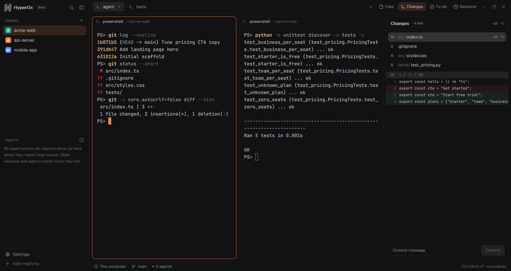
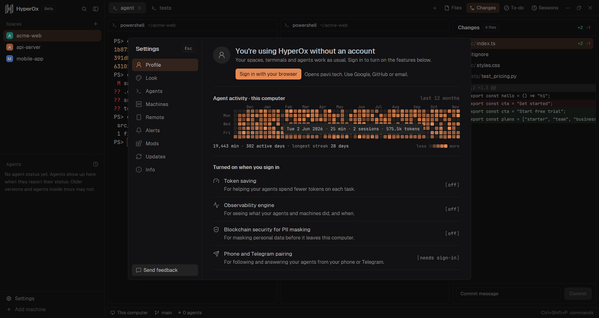
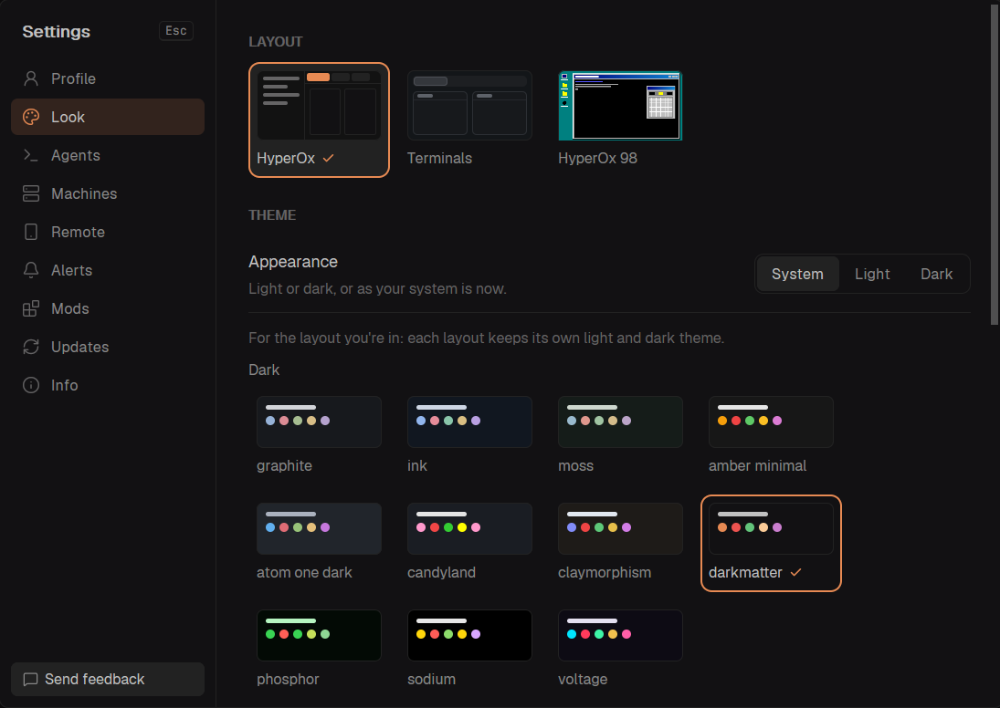
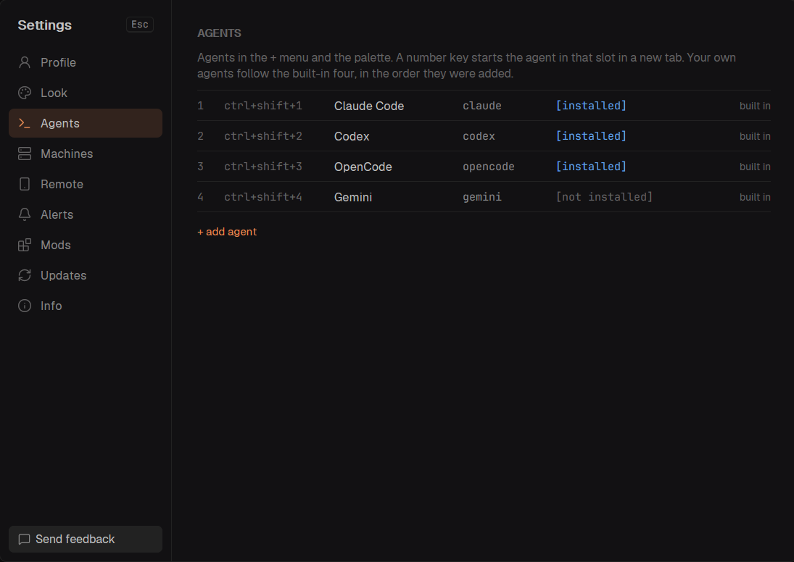

<p align="center">
  
</p>

<h1 align="center">HyperOx</h1>

<p align="center">
  <b>The desktop workspace for AI coding agents.</b><br>
  Run Claude Code, Codex, OpenCode, Gemini CLI and your own tools side by side, see what every agent is doing, and stay in control from your desk or your phone.
</p>

<p align="center">
  <a href="https://github.com/buckleson/h0x-ADE-Releases/releases/latest/download/h0x-ade-windows-x86_64.tar.gz"></a>
  <a href="https://github.com/buckleson/h0x-ADE-Releases/releases/latest/download/h0x-ade-macos-aarch64.tar.gz"></a>
  <a href="https://github.com/buckleson/h0x-ADE-Releases/releases/latest/download/h0x-ade-linux-x86_64.tar.gz"></a>
  <a href="https://github.com/buckleson/h0x-ADE-Releases/releases/latest/download/h0x-ade-linux-aarch64.tar.gz"></a>
</p>

<p align="center">
  <a href="https://pavii.tech/products/dev-tools/docs/"><b>Documentation</b></a> ·
  <a href="https://github.com/buckleson/h0x-ADE-Releases/releases"><b>Releases</b></a> ·
  <a href="https://pavii.tech"><b>Pavii</b></a> ·
  <a href="https://buckleson.com"><b>Buckleson</b></a>
</p>

<p align="center">
  
</p>

---

## Works with

<p align="center">
  
  
  
  
  
</p>

Each agent runs in a normal terminal, so anything you can start from a shell works. HyperOx also recognizes other agent CLIs (for example Cursor, Copilot, Amp, Kiro and Kimi) and shows their state.

## What you get

| Feature | What it does |
|---|---|
| Spaces, tabs and split panes | A space holds a project, tabs hold the agents and shells you run in it, panes split a tab. |
| Run any agent | Start Claude Code, Codex, OpenCode, Gemini CLI or your own program in a new tab with one shortcut. |
| Agents panel | Every agent with its state (working, blocked on you, done, idle). Pin the ones you care about, peek without switching tabs. |
| Files, Changes, To-do, Sessions | Edit files with autosave, review the git diff and commit, keep to-do lists, and reopen earlier sessions. |
| Remote machines | Connect over SSH and run agents on a server. They keep running while your laptop sleeps. |
| Phone and Telegram pairing | Pair an account to see your agents, get a notice when one finishes, and answer permission prompts away from your desk. |
| Activity graph | A calendar of your work with agents. It is computed and stored on your computer only. |
| Themes and layouts | Themes such as darkmatter, Sodium, Voltage and Phosphor, plus switchable layouts you can clone and change. |
| Mods | Small JavaScript programs that add panels, overlays and windows. Scriptable UI. |
| Signed releases and in-app updates | Every file is signed and checked before it installs. A bad update rolls back by itself. |
| Workspaces (0.1.34, coming with the next release) | Save the space you are in (tabs, panes, folders and running agents) and bring it back later. Up to 5 saved. |

### With an account

Signing in adds features that run through the HyperOx account:

| Feature | What it does |
|---|---|
| Token saving | Prompt caching to cut the tokens your agents spend. |
| Observability | Logs, traces and evals for your agent runs. |
| PII masking | Blockchain-backed masking of personal data. |

The full app is in beta and invite-only. See the [documentation](https://pavii.tech/products/dev-tools/docs/) for how to get access.

## Screenshots

<table>
  <tr>
    <td width="50%"><br><sub>Activity graph. Stays on your computer.</sub></td>
    <td width="50%"><br><sub>Themes and layouts.</sub></td>
  </tr>
  <tr>
    <td width="50%"><br><sub>Settings → Agents: add your own agents and CLI tools.</sub></td>
    <td width="50%"><br><sub>Spaces, tabs and panes in the main window.</sub></td>
  </tr>
</table>

## Keyboard shortcuts

Windows and Linux first, macOS second. Every key can be rebound in `keys.json` in the app folder.

| Action | Windows / Linux | macOS |
|---|---|---|
| Start an agent in a new tab (1 Claude Code, 2 Codex, 3 OpenCode, 4 Gemini CLI, 5-9 your own) | `Ctrl+Shift+1` ... `9` | `Ctrl+Shift+1` ... `9` |
| Command palette | `Ctrl+Shift+P` | `Cmd+Shift+P` |
| New tab / close tab | `Ctrl+Shift+T` / `Ctrl+Shift+W` | `Cmd+T` / `Cmd+W` |
| New space | `Ctrl+Shift+N` | `Cmd+N` |
| Go to tab 1-9 | `Ctrl+1` ... `9` | `Cmd+1` ... `9` |
| Next / previous tab | `Ctrl+Tab` / `Ctrl+Shift+Tab` | `Ctrl+Tab` / `Ctrl+Shift+Tab` |
| Go to space 1-9 | `Alt+1` ... `9` | `Ctrl+1` ... `9` |
| Split pane right / down | `Ctrl+Shift+O` / `Ctrl+Shift+E` | `Cmd+D` / `Cmd+Shift+D` |
| Move between panes | `Alt+Arrow` (or `Alt+H J K L`) | `Cmd+Alt+Arrow` |
| Zoom pane | `Ctrl+Shift+Z` | `Cmd+Shift+Enter` |
| Close pane | `Ctrl+Shift+X` | `Cmd+Shift+W` |
| Find in terminal | `Ctrl+Shift+F` | `Cmd+F` |
| To-do panel | `Ctrl+Shift+J` | `Cmd+Shift+J` |
| Show or hide the sidebar | `Ctrl+Shift+B` | `Cmd+B` |
| Settings | `Ctrl+,` | `Cmd+,` |
| Open a file named in a terminal, at its line | `Ctrl+click` | `Cmd+click` |
| Close Settings and dialogs | `Esc` | `Esc` |

## Install

| Platform | Command |
|---|---|
| macOS and Linux | `curl -fsSL https://github.com/vjk7989/h0x-ADE-app/releases/latest/download/install.sh \| sh` |
| Windows (PowerShell) | `powershell -c "irm https://github.com/vjk7989/h0x-ADE-app/releases/latest/download/install.ps1 \| iex"` |
| Manual | Download the `.tar.gz` for your platform from the buttons above or the [releases page](https://github.com/buckleson/h0x-ADE-Releases/releases), [verify it](#verify-your-download), unpack it and run `h0x-ade`. |

Requirements: Windows 10/11 x64, macOS on Apple Silicon, Linux x86_64 or aarch64.

On macOS, if the system blocks the app, sign it locally once:

```sh
xattr -dr com.apple.quarantine ~/Applications/HyperOx.app && codesign --force --deep --sign - ~/Applications/HyperOx.app
```

## Verify your download

Every release file has a [minisign](https://jedisct1.github.io/minisign/) signature next to it (`<file>.minisig`). The public key is:

```text
RWTEdqtOBn6VKQ/x9x3qWk/gIWUb/I1OlZXsTlHyrkp9Yq30qBki+tdt
```

```sh
minisign -Vm h0x-ade-linux-x86_64.tar.gz -P RWTEdqtOBn6VKQ/x9x3qWk/gIWUb/I1OlZXsTlHyrkp9Yq30qBki+tdt
```

[rsign2](https://github.com/jedisct1/rsign2) works the same way. The installers and the in-app updater check these signatures themselves.


## Updates

HyperOx keeps itself up to date: the app, the background engine (core) and the terminal runtime are checked together, and whichever part has a newer version is updated. The engine and runtime update once no agent has been working for 2 minutes, and your terminals keep running; the app updates when you quit it. A short notice tells you what was updated.

If a new version doesn't start properly, HyperOx goes back to the previous one by itself and lets you know. You can turn automatic updates off in **Settings**.

Engine and runtime files are published at [h0x-ADE-Core-Releases](https://github.com/buckleson/h0x-ADE-Core-Releases/releases) and [h0x-ADE-Runtime-Releases](https://github.com/buckleson/h0x-ADE-Runtime-Releases/releases).

## Your data (beta)

During the beta, HyperOx sends usage data and failure reports so we can fix problems and improve the app. You are identified by a random install ID, not your name or email. HyperOx never sends what you type, your prompts, agent replies, terminal contents, file or folder names, or your keys. IP addresses are not stored; your approximate location (country and city) is. After the beta we plan to move data collection to zero-knowledge proofs.

You can turn usage analytics off any time in **Settings → Info**. Failure reports (crashes and install or update problems) stay on so we can fix them.

## How it works

HyperOx has two parts that work together:

- **The app** is the window you see: tabs, layouts, agent status, settings and mods.
- **The engine** runs quietly in the background and keeps every terminal alive, even when the app is closed. It also powers phone and Telegram control and connections to other machines.

Because the engine owns the terminals, you can close or restart the app and your agents keep working.

## Safe by design

- Every release file is signed. HyperOx checks the signature before it installs or updates anything, and refuses a file that does not match.
- Downloads come only from the official HyperOx release pages, over a secure connection.
- During the beta HyperOx sends usage analytics and failure reports, never your code, prompts, terminal contents or keys. You can turn usage analytics off in **Settings → Info**; see [Your data (beta)](#your-data-beta).
- Agents that ask for permission, a sign-in or an answer wait for you. Only real permission prompts can be answered from your phone; questions and sign-ins must be answered at your computer.

## FAQ

**Is it free?** HyperOx is in early access (beta). The full app is invite-only; see the [documentation](https://pavii.tech/products/dev-tools/docs/).

**Where is my data?** Your activity graph is computed and kept on your computer. Terminals and files stay on the machines they run on.

**Do my agents stop when I close the window?** No. The engine keeps terminals running in the background and they are there when you open the app again.

## Need help?

Read the [documentation](https://www.pavii.tech/products/dev-tools/docs/), or visit [pavii.tech](https://pavii.tech) and [buckleson.com](https://buckleson.com).

## License

HyperOx binaries are released under the [Apache License 2.0](LICENSE). See [NOTICE](NOTICE) for the components they include and their licenses.

<p align="center">Made by <a href="https://pavii.tech">Team Pavii</a> · Security partner <a href="https://buckleson.com">Buckleson</a></p>
